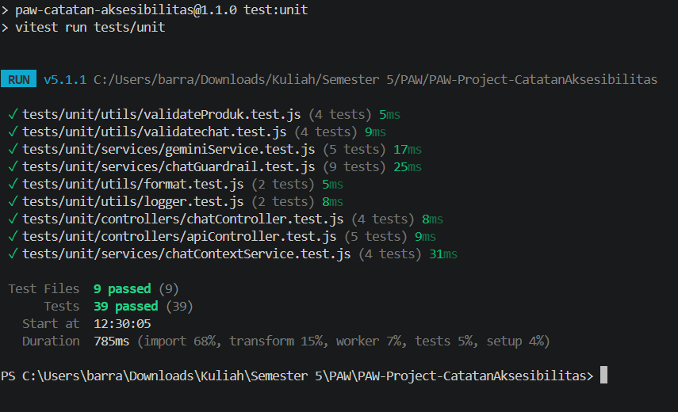
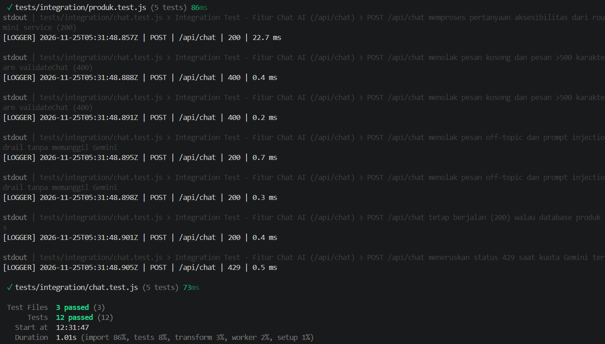
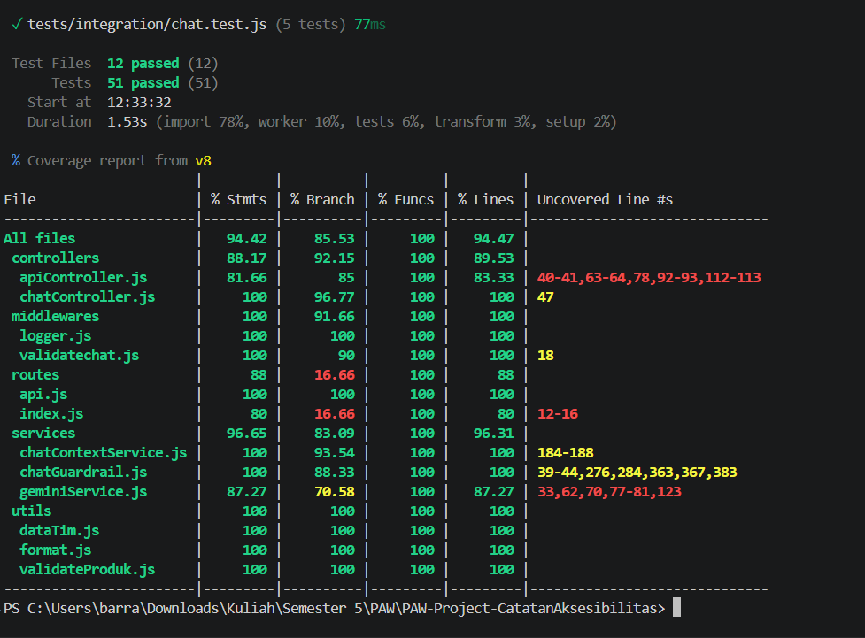

# Tugas Week 11 — Unit Testing, Integration Testing, dan Code Coverage

- **Kelas:** A
- **Project:** Catatan Aksesibilitas Web (`PAW-Project-CatatanAksesibilitas`)

## 1. Unit Testing
Menjalankan `npm run test:unit` untuk menguji fungsi validasi, middleware, guardrail, service konteks/Gemini, dan controller secara terisolasi.

## 2. Integration Testing
Menjalankan `npm run test:integration` menggunakan Supertest untuk menguji alur penuh endpoint `/api/status`, CRUD `/api/produk`, dan `/api/chat`.

## 3. Code Coverage
Menjalankan `npm run test:coverage` (`@vitest/coverage-v8`) untuk mengukur persentase Statements, Branches, Functions, dan Lines.

